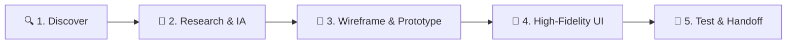

  <!-- Header Typing Animation -->
  

  

    <strong>Focused on research-driven, human-centered & conversion-focused design solutions</strong>
  

  <!-- Quick Status Badges -->
  

    
    
    
    
  

  <!-- Cover Banner -->
  

    
  

  <!-- Profile Visitor Counter -->
  

    
  

---

### 💡 Core Design Philosophy

> *"User-first design reduces rework, saves development time, and lowers business risk. If we understand users early, everything downstream moves faster."*

I partner with businesses, tech founders, and product teams to transform complex challenges into intuitive, scalable, and high-converting digital products across web, SaaS, and mobile platforms.

---

### 🚀 What I Do (Specializations)

<table>
  <tr>
    <td width="50%" valign="top">
      <h4>🎨 UI/UX & Product Design</h4>
      <ul>
        <li>Modern, clean & scalable SaaS dashboards</li>
        <li>Conversion-driven web app interfaces</li>
        <li>Native iOS & Android mobile UI</li>
        <li>Component-driven Design Systems & style guides</li>
      </ul>
    </td>
    <td width="50%" valign="top">
      <h4>🔍 UX Research & Product Audits</h4>
      <ul>
        <li>Usability testing & heuristic evaluations</li>
        <li>Identifying friction points & drop-offs</li>
        <li>User journey mapping & persona building</li>
        <li>Data-backed UX recommendations</li>
      </ul>
    </td>
  </tr>
  <tr>
    <td width="50%" valign="top">
      <h4>📐 Wireframing & Prototyping</h4>
      <ul>
        <li>Low & high-fidelity interactive prototypes</li>
        <li>Complex workflow & logic visualization</li>
        <li>Developer-ready handoffs with full annotations</li>
        <li>Micro-interaction & transition planning</li>
      </ul>
    </td>
    <td width="50%" valign="top">
      <h4>🏛️ Information Architecture (IA)</h4>
      <ul>
        <li>Structuring content & user flows for clarity</li>
        <li>Intuitive navigation hierarchies</li>
        <li>Reducing cognitive load for power users</li>
        <li>Design tokens & reusable pattern libraries</li>
      </ul>
    </td>
  </tr>
</table>

---

### 🛠️ Design Stack & Toolkit

  <!-- Design & Prototyping -->
  
  
  
  
  
  
  
  
  <!-- Dev Collaboration -->
  
  
  

---

### ⚡ My Work Methodology

1. **Research-led, not guess-led:** Real user feedback and data-driven insights over subjective opinions.
2. **Seamless Developer Collaboration:** Design systems structured around components and flex/grid logic for zero-friction handoffs.
3. **High-Impact Delivery:** Fast turnaround, iterative feedback loops, and practical execution built for real-world constraints.

---

### 📊 GitHub Activity & Metrics

  <table border="0">
    <tr>
      <td>
        
      </td>
      <td>
        
      </td>
    </tr>
  </table>

---

### 🤝 Let's Build Something Impactful Together

Whether you are building a new SaaS product from scratch, redesigning an existing web platform, or looking for an experienced design partner:

  
  
  
  

  Designed with precision by <strong>Md Atikur Rahman</strong> • © 2026

